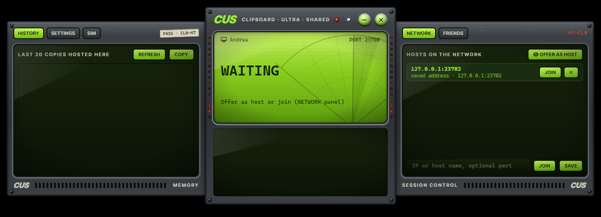
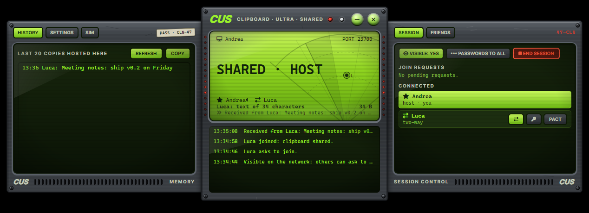
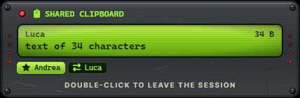

# CUS — Clipboard Ultra Shared

Share your clipboard in real time with other PCs on the same local network: with colleagues (after they consent) or with yourself on another machine.



## Features

- **AirDrop-style sessions:** one PC offers itself as host, others ask to join, and the host accepts each one as two-way or read-only.
- **Everything you copy:** text, images, files and folders (files are actually transferred, not just their paths).
- **Always-visible indicator:** while the clipboard is shared, an always-on-top badge shows who is connected and the last shared item; double-click it to leave the session.
- **Friends:** trusted peers can join without confirmation, or connect at any time.
- **Sensitive content:** copied passwords go only to friends marked as trusted and never enter the history.
- **End-to-end encrypted:** signed identities, encrypted channel (libsodium), local database whose key is protected by DPAPI on Windows and by the Secret Service keyring on Linux.





## Download

Every [release](../../releases) contains:

- Windows: `cus-setup-<version>-win-x64.exe` (installer) or `cus-<version>-win-x64.zip` (portable);
- Linux (x64 and arm64), all self-contained (no .NET runtime needed):
  - Debian/Ubuntu: `sudo apt install ./cus_<version>_amd64.deb` (or `_arm64.deb`);
  - Fedora/RHEL: `sudo dnf install ./cus-<version>-1.x86_64.rpm` (or `.aarch64.rpm`); openSUSE: `sudo zypper install` with the same file;
  - any distribution: `cus-<version>-x86_64.AppImage` (or `aarch64`), make it executable and run it;
  - or `cus-<version>-linux-x64.tar.gz` (or `linux-arm64`): extract it and run `./cus` from the extracted folder.

  The `.deb` and `.rpm` install CUS in `/opt/cus` with the `cus` command and a launcher in the applications menu. The Linux packages are built by `packaging/linux/build-packages.sh`;
- `SHA256SUMS.txt` to verify the downloads (`sha256sum -c SHA256SUMS.txt --ignore-missing`).

## Requirements

- Windows 10 1809 or later, or Linux (x64/arm64) with an X11 session or a Wayland session with XWayland (GNOME, KDE Plasma and most desktops)
- On Linux: `libX11`, `libXfixes`, `libsecret` and a Secret Service keyring (GNOME Keyring, KWallet or KeePassXC). On Debian/Ubuntu: `sudo apt install libx11-6 libxfixes3 libsecret-1-0 gnome-keyring`
- [.NET SDK](https://dotnet.microsoft.com/download) as pinned in `global.json` (to build)

## Build and run

Windows:

```powershell
dotnet build Cus.slnx
dotnet run --project src/Cus.App.Windows
```

Linux (the solution also contains the Windows-only projects, so build the Linux app directly):

```bash
dotnet run --project src/Cus.App.Linux
```

On Linux, received files are downloaded when you paste them (as on Windows) into a private cache folder, `~/.local/share/CUS/received-files`, and the file manager copies them from there; the folder is emptied when CUS starts and exits. Pasting a large file into a Qt app (Dolphin) may time out the first time: the download continues and the next paste is immediate. The tray icon needs a desktop with StatusNotifier support (KDE, or GNOME with the AppIndicator extension).

Useful options: `--profile <name>`, `--name <display name>`, `--port <port>` (default 23700), `--peer <host:port>`, `--bind <address>`, `--clipboard real|simulated`, `--no-discovery`.

Try two instances on one PC (separate profiles, simulated clipboard):

```powershell
./scripts/run-two-instances.ps1
```

## Tests

```powershell
dotnet test Cus.slnx
```

## Installer

Builds a self-contained `win-x64` package and an [Inno Setup](https://jrsoftware.org/isinfo.php) installer in `artifacts/`:

```powershell
./scripts/publish.ps1 -Version 0.1.0
```

For Linux, a self-contained folder (no .NET runtime needed on the target machine) with the `cus` executable:

```bash
dotnet publish src/Cus.App.Linux -c Release -r linux-x64 --self-contained -p:DebugType=none -o artifacts/publish/linux-x64
```
